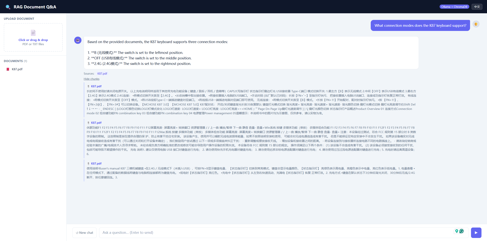
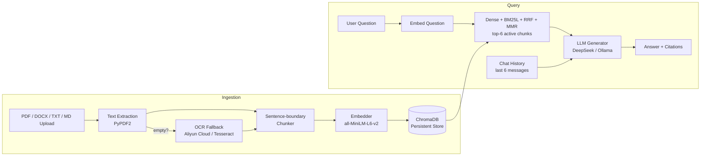

# RAG Document Q&A

## Answer evaluation (2026-10-16)

An [independent local evaluation suite](evaluation/README.md) tests 34 English/Chinese questions against 14 fictional documents through the real upload/ask API. It reports expected-evidence recall, fact-pattern checks, source coverage and refusals, generates a Promptfoo per-case HTML report, and supports response-bound human review. The first local Ollama run passed 32/34 rules; subsequent reading found additional contradictions that keyword checks missed. **Rule pass rate is not confirmed answer accuracy or hosted-model performance.** No production request behavior changed.

## Reliability update (2026-10-16)

[Development workflow, AI contributions, reproducible checks and limits](docs/DEVELOPMENT.md).

- Model answers are rendered through locally hosted DOMPurify (Apache-2.0 option; see `static/vendor/DOMPurify.LICENSE`). Markdown, code blocks and safe links remain supported.
- Document replacement stages new Chroma chunks and atomically selects them through `chroma_data/versions.sqlite3`. Back up the entire data directory, including that file. Run **one application worker per data directory**. Existing legacy chunks remain readable; uncommitted revisions are invisible after restart.
- Retrieval combines dense candidates with BM25L, reciprocal rank fusion and MMR diversity selection, returning up to six active passages. No second model is loaded. The disclosed 18-document/12-query development check recalled 11/12 target passages with dense search and 12/12 with hybrid search; this is not a general accuracy estimate.
- New uploads use the embedding model's actual tokenizer and sequence limit, including special tokens. Existing documents must be reindexed to receive the new chunking.
- API history accepts at most six user/assistant messages, 8,000 characters per message and 24,000 overall. The UI omits oversized whole turns with a visible notice; displayed answers remain intact.
- The hosted demo uses a separate `RAG_DATA_DIR=/opt/rag-demo/public_demo_data` with fictional public samples from `docs/public-demo-*.md`. The previous corpus is privately archived outside the website. Uploads to this unauthenticated demo are shared across visitors; never upload private files. Keep public-demo data out of Git and Docker build contexts.
- PDF/DOCX/TXT/MD extensions are case insensitive; DOCX body tables are extracted. Invalid document/UTF-8 input returns a client error. Generation failures emit an explicit SSE error event.


A production-style **Retrieval-Augmented Generation (RAG)** pipeline that lets you upload PDF, DOCX, TXT or Markdown documents and ask questions in natural language — answers are grounded in your own documents, with source citations.

**Live Demo:** https://zhenweishi-rag.com &nbsp;|&nbsp; Supports English and Chinese (中英文双语)



---

## Architecture



**Request flow:**
1. User uploads a document → text is extracted, split into sentence-aware chunks, embedded, and stored in ChromaDB
2. User asks a question → question is embedded, dense and BM25L candidates are fused and selected for relevance and diversity, passed to LLM with conversation history
3. LLM responds with an answer grounded in the retrieved context; UI shows source citations and inspectable chunks

---

## Features

| Feature | Detail |
|---|---|
| **PDF / DOCX / TXT / MD upload** | Drag-and-drop or click to upload |
| **OCR fallback** | Scanned PDFs auto-detected; uses Aliyun cloud OCR (4-thread parallel) or Tesseract locally |
| **Hybrid retrieval** | MiniLM + ChromaDB, BM25L + RRF + MMR, top-6 active chunks |
| **Multi-turn conversation** | Last 6 messages of chat history passed to LLM for context |
| **Source citations** | Every answer shows which document it came from |
| **Chunk inspection** | Expand to see the exact passages that informed the answer |
| **Streaming output** | Tokens stream to the UI in real time (Server-Sent Events) |
| **Pluggable LLM** | DeepSeek (cloud) or Ollama (local, fully private) via env var |
| **Persistent index** | ChromaDB persists to disk; documents survive server restarts |
| **Bilingual UI** | Toggle between English and Chinese |

---

## Tech Stack

| Layer | Technology |
|---|---|
| Web Framework | FastAPI (async) |
| Embedding Model | `all-MiniLM-L6-v2` (sentence-transformers) |
| Vector Store | ChromaDB (persistent, local) |
| LLM | DeepSeek API (cloud) or Ollama (local) |
| PDF Parsing | PyPDF2 + pdf2image + Aliyun OCR (cloud, fast) / Tesseract (local fallback) |
| Frontend | Vanilla JS, no build step |
| Deployment | Alibaba Cloud lightweight server, systemd + nginx reverse proxy |

---

## Design Decisions

**Why sentence-boundary chunking instead of fixed character splits?**
Splitting mid-sentence breaks semantic units and confuses the retrieval model. The chunker scans backward from the split point for sentence-ending punctuation (`. ! ? ;`) when it fits the actual tokenizer budget. Long sentences are split to stay within the embedding limit, so sentence completeness is not guaranteed.

**Why ChromaDB instead of Pinecone?**
ChromaDB runs locally with zero setup and persists to disk — no API key, no cost, no network call on every query. For a single-server demo this is faster and simpler. Pinecone would be the right call when scaling to multiple servers or needing managed infrastructure.

**Why DeepSeek over OpenAI?**
DeepSeek's API is OpenAI-compatible (drop-in replacement), costs ~20x less per token, and performance is comparable for document Q&A tasks. The codebase supports any OpenAI-compatible endpoint via env vars.

**Why no LangChain?**
Writing the RAG pipeline from scratch (chunker → embedder → vector store → generator) keeps the architecture transparent and avoids abstraction overhead. Each component is a small, testable module.

---

## Project Structure

```
rag-demo/
├── app.py              # FastAPI server — upload, ask, document management
├── rag/
│   ├── chunker.py      # Sentence-boundary-aware text chunking
│   ├── embedder.py     # Embedding model singleton (lazy-loaded, warm on startup)
│   ├── store.py        # ChromaDB persistent vector store
│   └── generator.py    # LLM wrapper (DeepSeek / Ollama, switchable via env)
├── static/
│   └── index.html      # Single-page UI (bilingual EN/ZH)
└── requirements.txt
```

---

## Quick Start

**Option A — Docker (optional; image build not verified in the 2026-10-16 test environment)**

```bash
git clone https://github.com/ZhenWei-Shi/rag-demo.git
cd rag-demo
cp .env.example .env          # fill in your API key
docker compose up --build
```

Open `http://localhost:8000`. ChromaDB data is persisted in a Docker volume.

---

**Option B — Cloud LLM (DeepSeek)**

```bash
git clone https://github.com/ZhenWei-Shi/rag-demo.git
cd rag-demo
pip install -r requirements.txt

# Set environment variables
export LLM_PROVIDER=openai_compat
export LLM_API_KEY=your_deepseek_key
export LLM_BASE_URL=https://api.deepseek.com
export LLM_MODEL=deepseek-chat

python app.py
```

**Option C — Local LLM (Ollama, fully private)**

```bash
# Install Ollama: https://ollama.com
ollama pull llama3.2

git clone https://github.com/ZhenWei-Shi/rag-demo.git
cd rag-demo
pip install -r requirements.txt
python app.py
```

Open `http://localhost:8000` in your browser.

---

## API Endpoints

| Method | Path | Description |
|---|---|---|
| `POST` | `/upload` | Upload and index PDF, DOCX, TXT or MD |
| `POST` | `/ask/stream` | Stream answer events and final sources |
| `POST` | `/ask` | Ask a question; returns answer, sources, and retrieved chunks |
| `GET` | `/documents` | List all indexed documents |
| `DELETE` | `/documents/{filename}` | Remove a document from the index |
